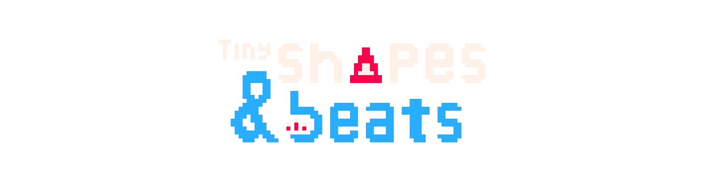
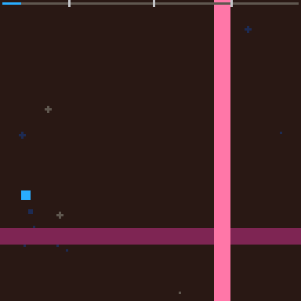

  

  

A fan-made demake of **Just Shapes & Beats** by **Berzerk Studio**, made to learn PICO-8. This is a non-commercial project.

The [MIT license](LICENCE) applies only to the original code written for this project. The original game's music, artwork and trademarks belong to their respective owners.
